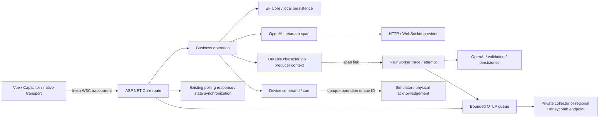

# Distributed tracing

Tracing is opt-in. The backend uses the vendor-neutral OpenTelemetry SDK and
OTLP HTTP/protobuf exporter; no Honeycomb SDK, collector service, or ingestion
key is required in the browser, iOS application, firmware or simulator.
The existing diagnostic SQLite store and operation journals work independently.
OpenTelemetry SDK/HTTP packages are pinned to 1.20.1; the official EF Core
instrumenter is pinned to upstream prerelease 1.20.1-beta.1. Revalidate exported
payloads and failure behavior before upgrading instrumentation packages.

## Trace flow



The client sends correlation context without exporting client spans. Each request
has a fresh trace ID: requests made later by polling, retries, or user actions
remain separate traces. The initial context is not a durable login/session ID.
There is no fabricated client waterfall, firmware span, or link across unrelated
requests. Physical-device journals, boot/session identities, and operation/cue IDs
remain the authority for device work. Backend command and acknowledgement spans
can be found by their opaque operation IDs; firmware does not parse W3C headers.

## Configuration

`backend/.env.example` is a reference, not an automatically loaded configuration
file. Use ASP.NET configuration/environment variables on the server:

| Setting | Behavior |
| --- | --- |
| `Backend__Telemetry__Enabled` | `false` by default; restart to change |
| `Backend__Telemetry__SampleRatio` | 1 outside Production, 0.1 in Production when omitted; finite 0 through 1 |
| `Backend__Telemetry__Environment` | Explicit resource environment, otherwise ASP.NET environment |
| `Backend__Telemetry__Logs__Enabled` | Separate opt-in, default false; requires telemetry enabled |
| `Backend__Telemetry__Logs__MinimumLevel` | Information, Warning or Error; defaults Warning in Production, Information elsewhere |
| `OTEL_SERVICE_NAME` | Defaults to `dildovander-backend` |
| `OTEL_EXPORTER_OTLP_PROTOCOL` | Supported protocol is `http/protobuf`; configured explicitly in code |
| `OTEL_EXPORTER_OTLP_TRACES_ENDPOINT` | Exact traces URL; default `http://127.0.0.1:4318/v1/traces` |
| `OTEL_EXPORTER_OTLP_ENDPOINT` | Fallback base URL, with `/v1/traces` appended |
| `OTEL_EXPORTER_OTLP_TRACES_HEADERS` | Private trace-specific OTLP headers; overrides generic headers |
| `OTEL_EXPORTER_OTLP_LOGS_ENDPOINT` | Exact log URL; generic base endpoint appends `/v1/logs`, otherwise loopback collector |
| `OTEL_EXPORTER_OTLP_LOGS_HEADERS` | Private log-specific headers; overrides generic headers |
| `OTEL_EXPORTER_OTLP_HEADERS` | Private generic OTLP headers |

For Honeycomb, choose the team's actual region before using
`https://api.honeycomb.io/v1/traces` (US) or
`https://api.eu1.honeycomb.io/v1/traces` (EU).
Configure `x-honeycomb-team=<private ingestion key>` in the private header setting.
The team slug does not establish its region. Use separate ingest keys and
environments for test and production; a resource environment label does not
change the environment selected by Honeycomb's key. See the
[official .NET setup](https://docs.honeycomb.io/send-data/dotnet/).
Only HTTPS is accepted except for loopback collectors. Do not send production
telemetry to a developer collector or an arbitrary third-party endpoint.

Resources include `service.name`, assembly informational `service.version`,
`deployment.environment.name`, and `vcs.ref.head.revision` from the SDK-generated
version suffix. Builds without embedded source revision report `unknown`; verify
the release resource rather than assuming a local build has a SHA. Resource
detectors and `OTEL_RESOURCE_ATTRIBUTES` are intentionally not used, avoiding
automatic export of host names, command lines or arbitrary extra metadata.

Batching is asynchronous: each signal has a queue of 2048 records, batches 256, scheduled every 5 seconds,
HTTP and exporter timeout 5 seconds. Export failures and queue saturation lose
telemetry rather than block requests or retry an application operation. There is
no disk spool and no guarantee of delivery on crash. The exporter does not trace
its own HTTP requests. SDK export is suppressed and Honeycomb/explicit collector
hosts are additionally excluded from outbound HTTP instrumentation.

## Safe log export

Log export is independently opt-in and uses the existing SDK packages. A dedicated
pipeline receives allowlisted `ServerLogStore` events and projected general
application logs. General logs export constant `application_log` bodies, known
backend type categories (other categories become fixed families), numeric event
IDs and normalized exception categories. UUID request/operation/conversation IDs
are read from explicitly named state and scope fields. No formatter is invoked;
message text, exception text/stacks, arbitrary state/scopes and event names stay
local. Known worker failure records already captured by `ServerLogStore` are
deduplicated. Normal application logger filters apply before this provider.
Framework categories always require at least Warning to avoid request/transport
information records for high-frequency audio uploads.

Structured events have a constant `diagnostic_event` body and explicit
`app.event.name`, finite failure codes, validated UUIDs, bounded numeric metadata,
and route templates verified against the configured endpoints. Unknown event
names become `diagnostic_event`; unknown codes/routes are omitted. Updating an
event producer may require updating this allowlist and its privacy tests.

Logs are not trace-sampled. A warning may carry a trace ID whose spans were
sampled out; it does not prove that a waterfall is available. Set the log-specific
endpoint and private headers; trace-specific headers are not a log fallback.
Disable only log export with `Backend__Telemetry__Logs__Enabled=false` and restart.
The [investigation runbook](observability-investigation.md) explains discovery,
signal filters, correlation and evidence limits for Codex.

## Correlation and compatibility

- `X-Request-Id` and existing diagnostic `traceId` remain the existing UUID request
  identity. Existing log endpoint filtering and iOS consumers retain this meaning.
- `X-Trace-Id` is the independent 32-hex W3C trace ID. The additional diagnostic
  `distributedTraceId` field bridges the log entry to Honeycomb. Span attribute
  `app.request_id` bridges in the other direction.
- `app.operation_id` is an opaque durable operation/job/cue ID; it can join
  independent attempts and acknowledgements. It is not a parent span ID.
- `app.conversation_id` is an opaque technical conversation ID when available;
  account, character/profile and visitor identity values are not exported.
- Character queue producer contexts are stored transactionally in
  `character_job_traces`, with foreign-key cascade deletion. The additive table
  contains only a W3C traceparent and job key. Old jobs have no link. Restarted and
  retried workers create new traces linked to that producer; no ambient unrelated
  request becomes their parent. `app.attempt` is the actual persisted attempt;
  `app.job.age_ms` is age since original enqueue, with the store's second precision.
- A client success/state refresh is observed as its own HTTP request. There is no
  claim that a successful worker proves that an iPhone rendered the new state.

## Instrumented operations

Automatic spans cover ASP.NET routes, outbound HTTP dependencies and EF Core
commands. HTTP names use server route templates, never raw paths. EF spans have
a fixed `db.query` name; SQL text/parameters and database file names are removed.
Handwritten SQLite stores are covered by the owning business/persistence span,
not automatic per-command database instrumentation.

Targeted spans cover account/authentication mutations, character save/context
read, queued enrichment attempts, AI response validation/context persistence,
tester session creation and API actions, Persona Lab turns/termination,
conversation initialization/termination, wand generation, duel creation/start,
keepsake worker jobs, memory retrieval/index jobs, twin commands and device cue
acknowledgements. Request business spans classify validation/authorization versus
execution; enrichment jobs record provider/persistence phase, outcomes, attempts
and retries. Safe `app.failure_code` values complement existing diagnostic logs.

OpenAI spans cover Live/Realtime connections and streams, delegated Responses,
character enrichment, wand and duel narration, keepsake story/image generation,
costume image processing, transcription, cue speech and vector-store operations.
They record provider/model, semantic operation, actual usage when available,
HTTP status, validated tool name/outcome and cancellation/timeout/error metadata.
No token count or
cost is synthesized. Live's provider-reported billed seconds are separate from
token usage and sum observed sessions across visual restarts. Aborting before a
final usage update can make this an observed lower bound; reserved/estimated
cost is never counted as provider usage. Successful scopes without provider
usage omit usage attributes.
First-output timing, stream lifetime and chunk/byte totals are aggregates, not
one span per output chunk. A stream remains open until its underlying operation
finishes or fails; long-running open spans are not sent until completion.
Configured timeouts and durable journals remain necessary for stuck operations.

Normal PCM upload requests and health checks are excluded from tracing. Polling
has ordinary HTTP spans but no additional business span. Twin clock/inspection
commands have no command span. Traces do not alter provider retries, cancellation,
consent checks, resource ownership, physical leases or actuator decisions.

## Privacy boundary

Only explicitly allowlisted scalar technical tags are exported. Unknown tags,
URLs, headers, bodies, SQL, paths, user identifiers and status descriptions are
removed before the exporter queue. W3C tracestate and baggage are removed from
export. Both the OpenTelemetry propagator and .NET's native HTTP propagator avoid
baggage; the native propagator accepts/emits only validated traceparent. Content-bearing
Activity events and links containing attributes/tracestate cause the entire span
to be dropped: .NET cannot remove Activity events through its public API. The
application instruments metadata tags instead of content events. This fail-closed
policy can omit a future framework error span, while its enclosing business/HTTP
operation and existing diagnostics remain available. Reassess instrumenter
upgrades with the serialized-payload privacy tests.

Do not add prompt, response, transcript, biography, image/audio, tool argument or
result capture, even for test accounts. Full AI content capture is a separate
future proposal requiring explicit approval, a consent/retention/access design,
and new privacy tests; it is disabled and unsupported here.

## Sampling and performance

Trace-ID ratio sampling ignores public caller sampled flags. The same trace ID
gets the same local decision, so client `00` flags do not disable backend test
tracing. Test starts at 100%; production defaults to 10% only when the ASP.NET
environment is Production. Set the explicit ratio when using custom environment
names. Sampling is probabilistic, not a security or volume limit: a malicious
caller can choose a trace ID. Existing request authorization/rate limits apply.

Head sampling can miss rare errors and cannot recover a discarded trace when it
fails later. Keep the local diagnostic store; use 100% sampling for a bounded
test/debug window. If production volume warrants trace-aware tail sampling, place
a collector/Refinery with complete trace affinity between backend and Honeycomb,
send it all spans, and define bounded memory/latency/error policies. No tail
sampler or new infrastructure is installed by this change. A sampled trace is
not a complete view of every request, and process crashes may leave no completed
span. No live audio performance or production load benchmark is claimed.

## Offline verification

From the repository root:

```powershell
dotnet restore backend-tests/BackendTests.csproj -p:SelfContained=true --locked-mode
dotnet build backend-tests/BackendTests.csproj -c Release -r win-x64 -p:SelfContained=true --no-restore
dotnet backend-tests/bin/Release/net10.0/win-x64/BackendTests.dll --observability
dotnet backend-tests/bin/Release/net10.0/win-x64/BackendTests.dll --server-logs
```

Linux CI uses `linux-x64` and runs `--observability` in its offline backend job.
The suite starts real loopback ASP.NET requests and SQLite/EF operations, runs the
official OTLP protobuf serializer into a controlled receiver, decodes exported
trace/span/parent IDs, and checks serialized payloads for representative secret
sentinels. It tests disconnected exporter handling, 100 audio uploads without a
span flood, safe metadata, remote parent `00` sampling, UUID log compatibility,
persisted job links after reopening SQLite, cancellation/timeouts, and scripted
SDK streaming. Ordinary tests make no paid provider calls or Honeycomb requests.
The log suite also decodes actual OTLP log records, checks opt-in/severity
defaults, unsampled trace correlation, scope/exception/content exclusion, frame
suppression and nonblocking logging during a collector stall.
The export handler simulates an unreachable destination; it does not prove the
network, live ingestion, regional key configuration or retention in Honeycomb.

## Deployment, rollback and views

Production deployment/merge/provider calls require separate approval. Install a
reviewed artifact containing the pinned packages and generated lockfiles. Inspect
the real service unit and loaded configuration privately before changing it;
deployment automation may regenerate environment files. Keep credentials outside
releases/source in operator-owned configuration with restricted permissions,
back up the current unit/environment, enable test ingestion first, and restart
only under deployment authority. Verify health, existing logs, resource SHA and a
safe synthetic request trace before considering a production sample ratio.

Rollback telemetry by setting `Backend__Telemetry__Enabled=false` and restarting
under that authority. Existing logs/journals remain active. To roll back the
artifact, use the existing release rollback process. The additive queue context
table can remain; do not delete jobs, customer state or diagnostic databases.

Live ingestion and dashboard creation require separate environment verification;
offline tests do not establish either. Once ingestion is independently confirmed,
use these view recipes
against actual discovered columns/datasets:

| View | Filters / useful breakdowns |
| --- | --- |
| Backend HTTP health | server spans, `http.route`, status; COUNT, P50/P95/P99 duration |
| OpenAI | `gen_ai.provider.name=openai`, model, operation, `error.type`, duration |
| Streaming reliability | Live/Realtime names, outcome, first-output/lifetime, disconnect phase |
| Character enrichment | queue worker names, attempt/outcome/phase, `app.operation_id`, linked producer |
| Tester / Persona Lab | business names, validation/authorization phase, safe errors and parent HTTP |
| Background jobs | memory/keepsake/enrichment names, retry outcome, attempts, durations |
| Dependencies | outbound HTTP / `db.query`, duration outliers; drill into waterfall |
| Devices | twin command / cue acknowledgement, operation ID and validated outcome |

These are documented recipes, not created Honeycomb objects. Do not interpret
client-submitted acknowledgement as independently measured physical movement.
